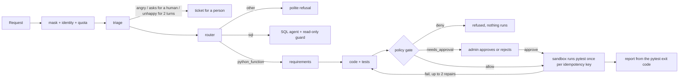

# CodeForge (team 404)

A coding-help bot built on LangGraph, using Groq models through a FastAPI backend and a React frontend.
**The model suggests, and plain Python decides.** Masking, identity, quotas, the code policy, the sandbox,
escalation and the report are pure functions that a model cannot talk its way past. A golden-set gate
in CI turns any weakened rule into a red build that names the failing case.



If the models are unavailable, the reliability layer goes through primary, then fallback, then the template tier.
The template tier only serves twelve reviewed tasks. For anything else it answers "cannot generate now" and opens
a ticket. It never auto-approves code.

## Run locally

Use two terminals. You need Python 3.10+ and Node 20+.

```bash
cp backend/.env.example backend/.env      # paste your Groq key into backend/.env
```

```bash
# terminal 1: backend on http://localhost:8000
cd backend
python -m venv .venv && source .venv/bin/activate    # Windows: run the backend in WSL
pip install -r requirements.txt
uvicorn main:app --port 8000                         # one worker, no --reload during demos
```

```bash
# terminal 2: frontend on http://localhost:5173
cd frontend
npm install
cp .env.example .env                                 # VITE_BACKEND_URL=http://localhost:8000
npm run dev
```

Backup console runner (it calls the same `service.submit()` as the API):

```bash
cd backend && python cli.py --user user_1 "Write a Python function that checks if a string is a palindrome"
```

Without a key the backend still runs. Model calls fail, and requests drop to the template tier or to rules only.

**Users** live in `backend/config.yaml`: `user_1`, `user_2`, `user_3` (role `user`) and `admin` (role `admin`).
Add or rename users there. The UI's "Signed in as" dropdown reads that list. Only roles listed in
`approver_roles` (by default `admin`) can approve paused code. Admins can see every run.

## Using the UI

* **Assistant page:** type a request (or pick an example) under *New request*. Every request stays in *History*,
  and clicking one reopens it. The selected request shows a progress bar (Understand → Generate → Safety check →
  Approval → Tests → Run it) and tabs: **Overview** (status, who answered, safety decision, report), **Code**,
  **Tests**, **Run**, **Test results** (pytest output) and **Ticket** when a person was asked to help.
* **Quality & reliability page:** the chaos, outage and replay switches (active switches also show in the header)
  and the golden-set gate as a table, one row per case.
* A yellow banner says when no Groq key is loaded. In that case answers come only from the built-in templates.

## Running generated code in the UI

The **Run** tab opens with a ready-to-run example call that uses real sample values, for example
`is_palindrome_number(121)`. Change the values and press Run. Output, errors and the value of the last line
appear on the right, as in a Python shell. Leave the box empty to run the code as a script.

* It runs in the same sandbox as the tests: a temp directory, no secrets, no network and a time limit.
* Only code that passed the policy gate, or that an admin approved, can run. Denied or rejected code never runs.
* Your snippet goes through the policy gate too. File, OS and network calls in a snippet are refused.
* Only the run's owner or an admin can run it. Every run counts toward the user's quota, and output is masked.

## Gate, tests and the chaos run

```bash
cd backend
python -m pytest -q tests              # unit tests for every rule
python -m evals.run_gate               # replay mode, no key: 14 hard + 11 soft cases
python -m evals.run_gate --record      # ONE time, with the key: records cassettes for the 11 soft cases
python -m evals.chaos_run              # 20 requests at 60% chaos -> evals/chaos_log.txt
python -m evals.chaos_run --outage     # total outage
```

* **Rule cases (H1–H14)** run the real graph with a stub model, so they test the rules, not the model.
  They pass without a key.
* **Model cases (S1–S11)** replay recorded Groq responses from `evals/cassettes/`, keyed by a hash of
  model + masked prompt. **Run `--record` once and commit the cassettes, or CI stays red.** Cassettes hold
  only masked text.
* The gate passes when 14/14 hard cases pass and at least 10 of 11 soft cases pass (85%, rounded up).
  It prints one line per failing case id and exits non-zero on a miss.
* **Red-to-green drill:** in `backend/policy.py`, remove `"system"` from `DENY_NAMES` and run the gate:
  it goes red and names **H9**. Restore it and the gate is green.

## HTTP contract

| Endpoint | Sends | Returns |
| --- | --- | --- |
| `GET /health` | nothing | mode, key loaded, model names, sandbox layers, breaker states, usage meter |
| `GET /users` | nothing | user ids and roles from `config.yaml` |
| `POST /submit` | `user_id`, `text`, `controls` {chaos, outage, replay} | `thread_id`, `status`, `request` (masked), `code`, `tests`, `sql`, `report`, `tier`, `policy`, `ticket`, `run` |
| `POST /resume` | `thread_id`, `user_id` (approver), `decision` approve/reject | same shape as `/submit` |
| `POST /execute` | `thread_id`, `user_id`, `snippet` | `exit_code`, `timed_out`, `output` (masked), `sandbox` |
| `POST /gate` | nothing | pass/fail per golden case, hard and soft totals |
| `GET /runs/{id}?user_id=` | nothing | the run if it is the caller's; the same 404 for missing and not-yours |
| `POST /feedback` | `user_id`, `thread_id`, `text` | appends a masked thumbs-down to `evals/feedback.jsonl` for the flywheel |

`status` is one of `done`, `awaiting_approval`, `escalated`, `denied`, `rejected`, `refused`, `unavailable` or `sql`.

## Where each requirement lives

| Area | Files |
| --- | --- |
| Level 1 pipeline | `graph.py`, `state.py`, `agents/`, `service.py`, `cli.py`, `main.py` |
| R1: identity, PII, quota, run access | `guard/mask.py`, `guard/identity.py`, `guard/quota.py`, `runs.py` |
| R2: policy, sandbox, approval, idempotency, report | `policy.py`, `sandbox.py`, `graph.py` (approval `interrupt()`), `runs.py`, `report.py` |
| R3: triage, escalation, tickets | `triage.py`, `escalation.py`, `tickets.py` |
| R5: retries, breaker, fallback, chaos, template tier | `llm/client.py`, `llm/reliability.py`, `templates/tasks.py` |
| R6: golden set and gate | `evals/golden_set.json`, `evals/hidden_tests/`, `evals/run_gate.py`, `.github/workflows/ci.yml` |
| R7 (optional): read-only SQL | `agents/agents.py` (`write_sql`), `sql_guard.py` |
| Running code from the UI | `service.execute()`, `sandbox.run_snippet()`, `frontend/src/components/RunPanel.tsx` |
| UI | `frontend/src/` (chat, run, result, approval, ticket, controls and gate panels) |

## Design decisions

1. **The degraded tier fails closed.** In a total outage, the template tier returns reviewed code for the
   twelve known tasks (string palindrome, number palindrome, factorial, fibonacci, fizzbuzz, list/tuple sum, reverse string, prime
   check, gcd, binary search, vowel count, anagram). For anything else it
   answers "cannot generate now" and opens a ticket. Template code still goes through the policy gate,
   because an outage is the worst moment to relax a safety rule.
2. **The report comes from pytest, not from the model.** A template is filled from the real exit code,
   so "tests passed" appears only when pytest exits with 0. Timeouts and failures are reported as they happened.
3. **Rules live in plain Python with unit tests, and an eval gate guards them.** Identity comes from
   `config.yaml`. Typing "I'm an admin" changes nothing. Only the admin role can approve
   paused code. Masking runs first on every request, again before every model call, and on every log line.

## Honest caveats

* `ast` analysis is a **policy layer, not a security boundary**. The sandbox is the second layer.
* **Sandbox:** a temp directory, a stripped environment (the Groq key is invisible to generated code),
  a timeout that kills the process group, rlimits on Unix, and a launcher that blocks sockets. `unshare -n`
  is added automatically on Linux when user namespaces allow it. `GET /health` shows which layers are active.
* **Identity:** the "Signed in as" dropdown stands in for login. Users come from `config.yaml`. Real use needs authentication.
* Paused approvals live in memory (`MemorySaver`). A backend restart forgets them. Resubmitting is safe
  because the idempotency key stops a second sandbox run.
* Groq rate limits are per organization and per model. Use replay for the gate, and run one eval at a time
  on a shared key.
